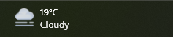
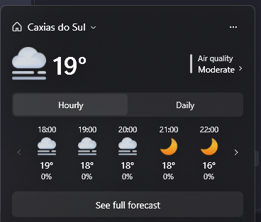

<div align="center">

# ElevenWeather

### Sin noticias. Sin feeds. Sin distracciones. Solo el clima.

Un indicador de clima ligero y de aspecto nativo para la barra de tareas de Windows 11.

<br>



<br>

[](#)
[](#)
[](https://github.com/rafaelkerni/ElevenWeather/actions/workflows/build.yml)
[](LICENSE)

**[English](README.md) | [Português](README.pt-BR.md) | Español**

</div>

---

## 🌤️ ¿Qué es ElevenWeather?

Windows 11 muestra el clima a través de su panel de **Widgets** — pero ese panel también trae un feed de noticias, titulares y contenido que no tiene nada que ver con consultar el clima.

**ElevenWeather** reemplaza ese único botón por un indicador exclusivo del clima que se ubica exactamente en el mismo lugar de la barra de tareas. Sin feed, sin titulares, sin paneles adicionales — solo la temperatura actual y, a un clic de distancia, un pronóstico por hora y diario.

> **Sin noticias. Sin feeds. Sin distracciones. Solo el clima.**

---

## ✨ Funciones

- 🌡️ Temperatura y condición actuales, directamente en la barra de tareas
- 🖱️ Haz clic para abrir una tarjeta de pronóstico compacta, con el estilo del flyout nativo de clima de Windows
- 🕐 Pronóstico por hora, paginado de 5 en 5 elementos
- 📅 Pronóstico diario, con el mismo diseño paginado
- 🫧 Índice de calidad del aire (US AQI)
- 🖥️ Un indicador por monitor, en un solo proceso — sin necesidad de ejecutar varias copias
- 📍 Ubicación detectada automáticamente en la primera ejecución (por IP), o configurada manualmente buscando una ciudad
- 🌙 Sigue el tema claro/oscuro de Windows automáticamente, en vivo — sin necesidad de reiniciar
- 🌐 Interfaz disponible en **portugués, inglés y español**, cambiable desde el menú
- 🌡️ Celsius o Fahrenheit, a tu elección
- 🎨 Elección del conjunto de íconos de clima — [Meteocons](https://bas.dev/work/meteocons) (predeterminado), [Fluent Emoji](https://github.com/microsoft/fluentui-emoji) (Flat), o los íconos nativos de MSN/Bing Weather (copiados desde la app Bing Weather instalada en tu PC, ver [Íconos de clima](#-íconos-de-clima))
- 🚀 Inicio con Windows opcional
- ⚡ Ligero: sin feed de noticias en segundo plano, sin telemetría, sin anuncios

---

## 🖥️ Vista previa

ElevenWeather ocupa el mismo lugar donde antes estaba el widget nativo de clima, alineado píxel a píxel con él.


Haz clic para abrir el flyout de pronóstico, con pestañas paginadas de pronóstico por hora y diario:



---

## 💡 ¿Por qué ElevenWeather?

El clima es información de un vistazo: miras la barra de tareas, ves la temperatura, y cuando quieres más detalles, haces clic. Esa es toda la interacción alrededor de la cual está construido ElevenWeather — **vistazo → clic → verificar → volver al trabajo** — sin nada que compita por tu atención en el medio.

---

## 🎯 Filosofía de diseño

**Solo el clima.** ElevenWeather no intenta convertirse en un panel completo. Ya existen excelentes aplicaciones para gráficos detallados, imágenes de radar y estadísticas a largo plazo — esta no es una de ellas. Se enfoca en la información del clima que la gente realmente consulta de un vistazo durante el día.

**Aspecto nativo.** Una utilidad que vive en la barra de tareas debería sentirse como si perteneciera ahí. El indicador y el flyout de ElevenWeather siguen el propio lenguaje visual de Windows 11 (Segoe UI Variable, íconos Fluent, desenfoque acrílico, temas claro/oscuro) en lugar de parecer una aplicación de terceros mal integrada.

**Ligero y discreto.** Sin ventanas emergentes exigiendo atención, sin notificaciones, sin feed de contenido. El clima está disponible cuando lo pides e invisible el resto del tiempo.

---

## 🚀 Instalación

Todavía no hay instalador ni versión publicada — consulta [Compilar desde el código fuente](#-compilar-desde-el-código-fuente) más abajo.

Una vez que se publique una versión, los pasos serán:

1. Descarga la última versión desde la página de Releases del repositorio.
2. Extráela y ejecuta `ElevenWeather.exe`.
3. En la primera ejecución, tu ubicación se detecta automáticamente; puedes cambiarla en cualquier momento desde el menú del flyout.

ElevenWeather está pensado para **Windows 11**.

> **Nota:** ElevenWeather no está firmado digitalmente. Es probable que Windows SmartScreen muestre una advertencia de "Editor desconocido" la primera vez que lo ejecutes — esto es lo esperado para una aplicación gratuita y de código abierto sin un certificado de firma pago, no una señal de que algo está mal. Haz clic en **Más información → Ejecutar de todas formas** para continuar. Puedes inspeccionar el código fuente (o compilarlo tú mismo) antes de confiar en él.

---

## ⚙️ Configuración

Disponible hoy, desde el menú "•••" en el flyout:

- Cambiar ubicación (búsqueda por nombre de ciudad)
- Iniciar con Windows
- Idioma de la interfaz (portugués / inglés / español)
- Unidad de temperatura (Celsius / Fahrenheit)
- Conjunto de íconos de clima (Meteocons / Fluent Emoji / MSN — ver [Íconos de clima](#-íconos-de-clima) más abajo)
- Actualizar el clima ahora

Aún no configurable:

- Intervalo de actualización (fijo en 15 minutos)
- Múltiples ubicaciones guardadas

---

## 🌎 Datos del clima

ElevenWeather funciona con **[Open-Meteo](https://open-meteo.com/)** — una API de clima gratuita y de datos abiertos que no requiere clave de API para uso no comercial. Proporciona condiciones actuales, pronóstico por hora, pronóstico diario y datos de calidad del aire.

La ubicación se resuelve mediante:
- Geolocalización por IP (a través de [ipwho.is](https://ipwho.is/)) en la primera ejecución, para sugerir una ubicación inicial, y
- La API de geocodificación de Open-Meteo cuando buscas una ciudad manualmente.

ElevenWeather no genera ni predice datos del clima por sí mismo — la precisión del pronóstico depende enteramente de las fuentes de datos propias de Open-Meteo.

---

## 🎨 Íconos de clima

Elige un conjunto de íconos desde el menú "•••" → *Íconos*:

- **[Meteocons](https://bas.dev/work/meteocons)** de Bas Milius (predeterminado) — con licencia MIT, incluido en el repositorio.
- **[Fluent Emoji](https://github.com/microsoft/fluentui-emoji)** (estilo Flat) de Microsoft — con licencia MIT, incluido en el repositorio.
- **MSN / Bing Weather** — los íconos usados por el propio widget de clima de Windows. Pertenecen a Microsoft y no se pueden redistribuir, por lo que no están incluidos en el repositorio ni en las releases. En su lugar, la primera vez que eliges este conjunto en el menú, la app los copia localmente desde la aplicación El Tiempo (Bing Weather) ya instalada en tu equipo Windows (no se descarga nada). Si esa aplicación no está instalada, la opción muestra un aviso y se mantiene el conjunto actual.

Texto completo de las licencias de los conjuntos incluidos: [THIRD_PARTY_NOTICES.md](THIRD_PARTY_NOTICES.md).

---

## 🔒 Privacidad

ElevenWeather no tiene cuentas, telemetría ni publicidad. Las únicas solicitudes de red que realiza son las necesarias para funcionar:

- Obtener datos de clima y calidad del aire desde Open-Meteo
- Resolver tu ubicación por IP (una vez, en la primera ejecución) o por búsqueda de ciudad
- Nada más — sin analítica, sin reporte de fallos, sin pings en segundo plano

Tu ubicación aproximada (latitud/longitud) se envía a Open-Meteo para obtener el pronóstico de ese lugar.

---

## 🧩 Relación con los Widgets de Windows

ElevenWeather es **independiente del sistema de Widgets de Windows** — no lo deshabilita, no se conecta a él ni reemplaza sus otras funciones (noticias, acciones, calendario, etc.).

Está pensado para quienes mantienen los Widgets activados básicamente por tener el clima en la barra de tareas: desactiva los Widgets en la Configuración de Windows, y ElevenWeather cubre ese único vacío.

---

## 🛠️ Compilar desde el código fuente

### Requisitos

- Windows 11 (o Windows 10 para desarrollo)
- [.NET 8 SDK](https://dotnet.microsoft.com/download/dotnet/8.0)
- Git

### Clonar, compilar y ejecutar

```bash
git clone https://github.com/rafaelkerni/ElevenWeather.git
cd ElevenWeather
dotnet build
```

Ejecuta el ejecutable compilado directamente:

```bash
src/ElevenWeather/bin/Debug/ElevenWeather.exe
```

...o ejecútalo directamente desde la CLI:

```bash
dotnet run --project src/ElevenWeather
```

Abrir `ElevenWeather.sln` en Visual Studio y ejecutar el proyecto `ElevenWeather` también funciona.

### Ejecutar las pruebas

Las pruebas unitarias (xUnit) cubren los services, la programación de actualizaciones de `WeatherStore`, los view models y los converters. Las llamadas HTTP, el timer y el almacenamiento de la configuración son simulados, y las pruebas de registro usan una clave desechable, así que nada en tu equipo se modifica:

```bash
dotnet test
```

### Compilar una versión standalone de release

Para generar un único `.exe` autocontenido (sin necesidad de instalar el runtime de .NET en el equipo de destino):

```bash
dotnet publish src/ElevenWeather -c Release -r win-x64 --self-contained -p:PublishSingleFile=true
```

El resultado queda en `src/ElevenWeather/bin/Release/win-x64/publish/`.

---

## 📁 Estructura del proyecto

```text
ElevenWeather/
├── src/ElevenWeather/
│   ├── Interop/       # Interop con Win32: seguimiento de la barra de tareas, estilo de ventana, acrílico
│   ├── Models/         # Tipos de datos de clima, localización, configuración de la app
│   ├── Services/       # Servicios de clima/ubicación/configuración, autostart, monitor de tema
│   ├── ViewModels/      # View models MVVM de la píldora de la barra de tareas y del flyout
│   ├── Views/          # La ventana de la barra de tareas y la ventana del flyout de pronóstico
│   └── Resources/      # Diccionarios de tema y conjuntos de íconos de clima (Icons/Meteocons, Icons/FluentEmoji)
├── tests/ElevenWeather.Tests/  # Pruebas unitarias (xUnit), sin acceso a la red
└── ElevenWeather.sln
```

---

## 🤝 Contribuciones

Las contribuciones son bienvenidas — corrección de errores, documentación, traducciones o una mejor forma de implementar algo.

```bash
git checkout -b feature/mi-mejora
# haz tus cambios
git commit -m "Add my improvement"
git push origin feature/mi-mejora
```

Luego abre un Pull Request. Para cambios más grandes, es buena idea abrir primero un issue para discutir el enfoque.

---

## 🐛 Reportar errores

Abre un issue con: qué pasó, qué esperabas, pasos para reproducirlo, tu versión de Windows y una captura de pantalla si es relevante.

---

## 📄 Licencia

ElevenWeather se distribuye bajo la **Licencia MIT** — ver [LICENSE](LICENSE).

---

## Aviso legal

ElevenWeather es un proyecto independiente de código abierto. **No está afiliado, respaldado, patrocinado ni asociado de ninguna forma con Microsoft Corporation**. Microsoft, Windows y Windows 11 son marcas registradas del grupo de empresas Microsoft.

<div align="center">

<br>

**Sin noticias. Sin feeds. Sin distracciones. Solo el clima.**

Hecho para Windows 11.

</div>
