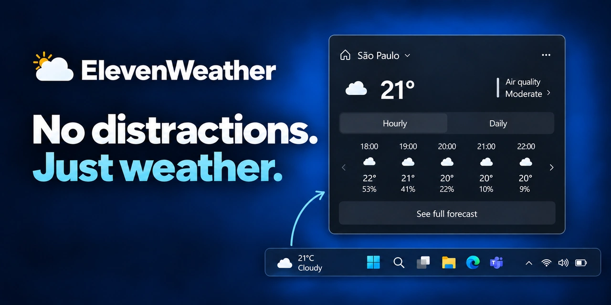

<div align="center">

# ⛅ ElevenWeather

A lightweight, native-looking weather indicator for the Windows 11 taskbar.

<br>



<br>

[](#)
[](#)
[](https://github.com/rafaelkerni/ElevenWeather/actions/workflows/build.yml)
[](LICENSE)
[](https://github.com/sponsors/rafaelkerni)

**English | [Português](README.pt-BR.md) | [Español](README.es.md)**

</div>

---

## 🌤️ What is ElevenWeather?

Windows 11 shows the weather through its **Widgets** panel — but that panel also brings a news feed, headlines and content that has nothing to do with checking the weather.

**ElevenWeather** replaces that single button with a weather-only indicator that lives in the exact same spot on the taskbar. No feed, no headlines, no extra panels — just the current temperature and, one click away, an hourly and daily forecast.

---

## ✨ Features

- 🌡️ Current temperature and condition, directly on the taskbar
- 🖱️ Click to open a compact forecast card, styled after the native Windows weather flyout
- 🕐 Hourly forecast, paginated 5 items at a time
- 📅 Daily forecast, same paginated layout
- 🫧 Air quality index (US AQI)
- 🖥️ One indicator per monitor, in a single process — no need to run multiple copies
- 📍 Location detected automatically on first run (by IP), or set manually by searching a city
- 🌙 Follows the Windows light/dark theme automatically, live — no restart needed
- 🌐 Interface available in **Portuguese, English and Spanish**, switchable from the menu
- 🌡️ Celsius or Fahrenheit, your choice
- 🎨 Choice of weather icon set — [Meteocons](https://bas.dev/work/meteocons) (default), [Fluent Emoji](https://github.com/microsoft/fluentui-emoji) (Flat), or the native MSN/Bing Weather icons (copied from the Bing Weather app installed on your PC, see [Weather icons](#-weather-icons))
- 🚀 Optional start with Windows
- ⚡ Lightweight: no background news feed, no telemetry, no ads

---

## 🖥️ Preview

ElevenWeather sits in the same place the native weather widget used to, matched pixel-for-pixel against it.


Click it to open the forecast flyout, with paginated hourly and daily tabs:


---

## 💡 Why ElevenWeather?

Weather is glanceable information: you look at the taskbar, you see the temperature, and when you want more you click it. That's the whole interaction ElevenWeather is built around — **glance → click → check → get back to work** — with nothing competing for your attention in between.

---

## 🎯 Design philosophy

**Just weather.** ElevenWeather isn't trying to become a dashboard. There are already excellent apps for detailed charts, radar imagery and long-range statistics — this isn't one of them. It focuses on the weather information people actually glance at during the day.

**Native-looking.** A utility that lives on the taskbar should feel like it belongs there. ElevenWeather's indicator and flyout follow Windows 11's own visual language (Segoe UI Variable, Fluent icons, acrylic blur, light/dark theming) rather than looking like a bolted-on third-party app.

**Lightweight and unobtrusive.** No popups demanding attention, no notifications, no content feed. The weather is available when you ask for it and invisible the rest of the time.

---

## 🚀 Installation

1. Turn off the Windows **Widgets** button — ElevenWeather sits in the same spot of the taskbar, so the two overlap if both are enabled. Go to **Settings → Personalization → Taskbar → Taskbar items** and switch **Widgets** to **Off**.
2. Download the latest `ElevenWeather-vX.Y.Z-win-x64.zip` from the [Releases page](https://github.com/rafaelkerni/ElevenWeather/releases/latest).
3. Extract it and run `ElevenWeather.exe` — it's a single self-contained file, no .NET install needed.
4. On first run, your location is detected automatically; you can change it any time from the flyout's menu.

Prefer to build it yourself? See [Building from source](#-building-from-source) below.

ElevenWeather targets **Windows 11**.

> **Note:** ElevenWeather isn't code-signed. Windows SmartScreen will likely show an "Unknown publisher" warning the first time you run it — this is expected for a free open-source app without a paid signing certificate, not a sign of anything wrong. Click **More info → Run anyway** to proceed. You're welcome to inspect the source (or build it yourself) before trusting it.

---

## ⚙️ Configuration

Available today, from the "•••" menu in the flyout:

- Change location (search by city name)
- Start with Windows
- Interface language (Portuguese / English / Spanish)
- Temperature unit (Celsius / Fahrenheit)
- Weather icon set (Meteocons / Fluent Emoji / MSN — see [Weather icons](#-weather-icons) below)
- Refresh weather now

Not configurable yet:

- Refresh interval (fixed at 15 minutes)
- Multiple saved locations

---

## 🌎 Weather data

ElevenWeather is powered by **[Open-Meteo](https://open-meteo.com/)** — a free, open-data weather API that requires no API key for non-commercial use. It provides current conditions, hourly forecast, daily forecast and air quality data.

Location is resolved by:
- IP-based geolocation (via [ipwho.is](https://ipwho.is/)) on first run, to suggest a starting location, and
- Open-Meteo's geocoding API when you search for a city manually.

ElevenWeather doesn't generate or predict weather data itself — forecast accuracy depends entirely on Open-Meteo's own data sources.

---

## 🎨 Weather icons

Pick an icon set from the "•••" menu → *Icons*:

- **[Meteocons](https://bas.dev/work/meteocons)** by Bas Milius (default) — MIT-licensed, bundled in the repo.
- **[Fluent Emoji](https://github.com/microsoft/fluentui-emoji)** (Flat style) by Microsoft — MIT-licensed, bundled in the repo.
- **MSN / Bing Weather** — the icons used by Windows' own weather widget. These belong to Microsoft and aren't redistributable, so they are not bundled in the repo or in releases. Instead, the first time you pick this set in the menu, the app copies them locally from the Weather (Bing Weather) app already installed on your Windows machine (nothing is downloaded). If that app isn't installed, the option shows a message and the current set is kept.

Full license text for the bundled sets: [THIRD_PARTY_NOTICES.md](THIRD_PARTY_NOTICES.md).

---

## 🔒 Privacy

ElevenWeather doesn't have accounts, telemetry, or advertising. The only network requests it makes are the ones needed to work:

- Fetching weather and air quality data from Open-Meteo
- Resolving your location by IP (once, on first run) or by city search
- Nothing else — no analytics, no crash reporting, no background pings

Your approximate location (latitude/longitude) is sent to Open-Meteo to retrieve the forecast for that spot.

---

## 🧩 Relationship to Windows Widgets

ElevenWeather is **independent from the Windows Widgets system** — it doesn't disable it, hook into it, or replace its other features (news, stocks, calendar, etc.).

It's meant for people whose main reason to keep Widgets enabled is simply having weather on the taskbar: turn Widgets off in Windows Settings, and ElevenWeather fills that one gap.

---

## 🛠️ Building from source

### Requirements

- Windows 11 (or Windows 10 for development)
- [.NET 8 SDK](https://dotnet.microsoft.com/download/dotnet/8.0)
- Git

### Clone, build and run

```bash
git clone https://github.com/rafaelkerni/ElevenWeather.git
cd ElevenWeather
dotnet build
```

Run the built executable directly:

```bash
src/ElevenWeather/bin/Debug/ElevenWeather.exe
```

...or launch it straight from the CLI:

```bash
dotnet run --project src/ElevenWeather
```

Opening `ElevenWeather.sln` in Visual Studio and running the `ElevenWeather` project works too.

### Running the tests

Unit tests (xUnit) cover the services, the refresh scheduling in `WeatherStore`, the view models and the converters. HTTP calls, the timer and settings storage are faked, and registry tests use a throwaway key, so nothing on your machine is touched:

```bash
dotnet test
```

### Building a standalone release build

To produce a single self-contained `.exe` (no .NET runtime install required on the target machine):

```bash
dotnet publish src/ElevenWeather -c Release -r win-x64 --self-contained -p:PublishSingleFile=true -p:IncludeNativeLibrariesForSelfExtract=true -p:EnableCompressionInSingleFile=true -p:DebugType=None
```

The output lands in `src/ElevenWeather/bin/Release/win-x64/publish/`.

---

## 📁 Project structure

```text
ElevenWeather/
├── src/ElevenWeather/
│   ├── Interop/       # Win32 interop: taskbar tracking, window styling, acrylic
│   ├── Models/         # Weather data types, localization, app settings
│   ├── Services/       # Weather/location/settings services, autostart, theme watcher
│   ├── ViewModels/      # MVVM view models for the taskbar pill and the flyout
│   ├── Views/          # The taskbar window and the forecast flyout window
│   └── Resources/      # Theme dictionaries and weather icon sets (Icons/Meteocons, Icons/FluentEmoji)
├── tests/ElevenWeather.Tests/  # Unit tests (xUnit), no network access
└── ElevenWeather.sln
```

---

## 🤝 Contributing

Contributions are welcome — bug fixes, docs, translations, or a better way to implement something.

```bash
git checkout -b feature/my-improvement
# make your changes
git commit -m "Add my improvement"
git push origin feature/my-improvement
```

Then open a Pull Request. For larger changes, opening an issue first to discuss the approach is a good idea.

---

## 🐛 Reporting bugs

Please open an issue with: what happened, what you expected, steps to reproduce, your Windows version, and a screenshot if relevant.

---

## 💖 Supporting the project

ElevenWeather is free and open source, with no ads and no telemetry. If it's useful to you and you'd like to support its development, you can do so through **[GitHub Sponsors](https://github.com/sponsors/rafaelkerni)** — any amount helps, and it's entirely optional.

Starring the repository, reporting bugs and sharing the app with others are great ways to help too.

---

## 📄 License

ElevenWeather is distributed under the **MIT License** — see [LICENSE](LICENSE).

---

## Disclaimer

ElevenWeather is an independent open-source project. It is **not affiliated with, endorsed by, sponsored by, or otherwise associated with Microsoft Corporation**. Microsoft, Windows and Windows 11 are trademarks of the Microsoft group of companies.

<div align="center">

<br>

**No news. No feeds. No distractions. Just weather.**

Made for Windows 11.

</div>
